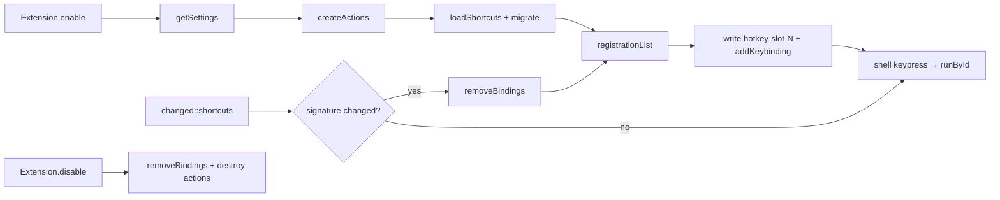
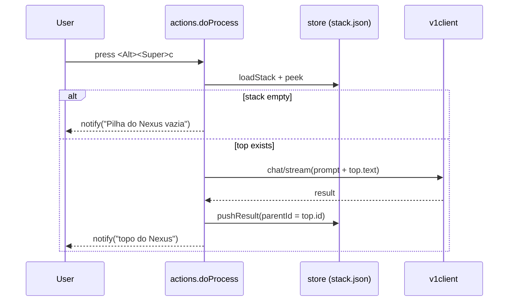
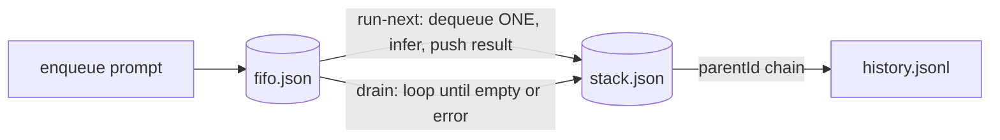
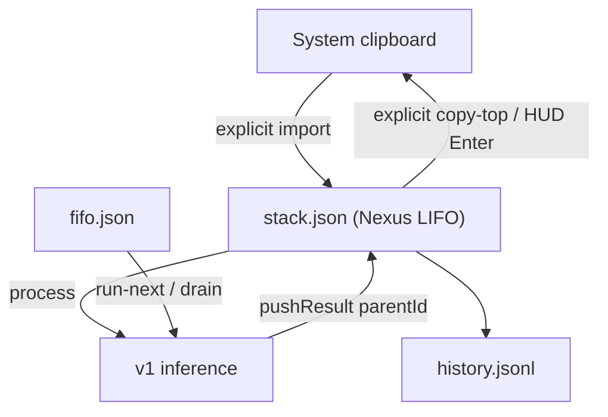

# Architecture — Nexus Clip GNOME Extension

A GNOME Shell 45–50 extension (ESM / GJS) that gives Nexus its **own clipboard**: a LIFO
stack of inputs/results, a FIFO of prompts, user-defined shortcuts with per-shortcut
prompts, and inference over an OpenAI-compatible `/v1` endpoint.

The system clipboard is a **boundary**, not the storage. It is read only by the explicit
import action and written only by explicit export actions (ADR-0008). The shell process
never creates GTK widgets (ADR-0009); in-shell UI is built with St/Clutter (ADR-0010).

> Scope: **POC, linear.** The `/v1` HTTP contract is the integration seam for a future
> C + llama.cpp implementation. A branching tree is a non-goal, but nodes already carry
> `id`/`parentId` so it can be layered on without a schema break.

---

## 1. Runtime & constraints

- **GNOME Shell 45–50**, developed/validated on **50.3 Wayland**. ESM is mandatory
  (GNOME 45+); legacy `imports.gi` loading is not used.
- **GJS** with `gi://Soup?version=3.0` (libsoup3), `gi://St`, `gi://Clutter`, and the
  GNOME Shell resource modules. Prefs use `gi://Gtk?version=4.0` / `gi://Adw?version=1`
  in their own process.
- Hard constraints discovered empirically (see `docs/adr/`):
  - `Soup.Session.send_and_read_async` is **not promisified** by GJS → pass the callback.
  - `send_finish()` on a `send_async` result returns a `Gio.InputStream` to read in chunks.
  - GJS `TextDecoder` has **no `{stream:true}`** → a pure incremental UTF-8 decoder is used.
  - The gateway keeps the socket open after `data: [DONE]` → `[DONE]` is the terminator.
  - **GTK inside the shell process deadlocks Wayland** (the old Super+X freeze) → St only.

---

## 2. Module map

```
extension/
├── metadata.json              # uuid nexus-clip@bbanho, schema, shell-version 45..50
├── extension.js               # Extension: enable/disable + dynamic keybinding slots
├── prefs.js                   # ExtensionPreferences: API / shortcuts / Nexus / help
├── schemas/
│   └── org.gnome.shell.extensions.nexus-clip.gschema.xml
└── lib/
    ├── actions.js             # orchestration: import/process/export/FIFO/HUD
    ├── config.js              # GSettings glue: shortcut migration/save, API config
    ├── shortcuts.js           # PURE: modes, canonical accelerators, validation, defaults
    ├── hud.js                 # St/Clutter stack viewer + live streaming panel
    ├── v1client.js            # HTTP: chat() (non-stream) and stream() (SSE)
    ├── v1core.js              # PURE: buildMessages / buildPayload / parseCompletion
    ├── sse.js                 # PURE: createSseParser + createUtf8Decoder
    ├── store-core.js          # PURE: LIFO/FIFO semantics, node shape, schemaVersion
    ├── store-io.js            # serialization over an injected file adapter
    └── store.js               # GJS/Gio adapter (shell + prefs)

tests/
├── helpers/
│   └── store-node.js          # Node fs adapter used by the tests
├── store-core.test.js
├── store-node.test.js
├── shortcuts.test.js
├── config.test.js
├── v1core.test.js
├── sse.test.js
├── gjs-store-smoke.mjs
└── gjs-client-smoke.mjs
```

| Module | Responsibility | Testable in Node? |
|--------|----------------|-------------------|
| `shortcuts.js` | Shortcut schema, canonicalization, defaults/migration, validation | ✅ pure |
| `config.js` | GSettings read/write, migration, registration signature | ✅ fake settings |
| `store-core.js` | LIFO/FIFO semantics, node shape, clamping | ✅ pure |
| `store-io.js` | JSON/JSONL serialization over injected primitives | ✅ via adapters |
| `store-node.js` (in `tests/helpers/`) | Node filesystem adapter | ✅ |
| `v1core.js` | Payload/message building + completion parsing | ✅ pure |
| `sse.js` | SSE framing + incremental UTF-8 decoding | ✅ pure |
| `store.js` | Gio persistence adapter | ⚠️ GJS smoke |
| `v1client.js` | Network I/O (libsoup3), cancellable + timeout | ⚠️ GJS smoke |
| `hud.js` | St/Clutter stack viewer + streaming panel | ⚠️ shell UI |
| `actions.js` | Orchestration (`St.Clipboard`, notifications, busy guard) | ⚠️ shell only |
| `prefs.js` | Preferences UI (GTK/Adw in a separate process) | ⚠️ manual |

**Principle:** all *logic* lives in pure modules tested by `node --test`; GJS/UI modules
stay thin and are exercised by GJS smoke tests or manually in the shell (`EVIDENCE.md`).

---

## 3. Extension lifecycle



- `enable()` builds the action set and registers one shell keybinding per **registration
  entry** (non-empty, de-duplicated accelerator), using schema slots
  `hotkey-slot-0..11`.
- `changed::shortcuts` re-grabs only when the `(id, accel)` signature changes. Prompt and
  label edits are picked up lazily: the handler resolves the shortcut **by id** from
  current settings on every keypress.
- `disable()` removes the slots it registered, cancels an in-flight request, closes HUD
  overlays, and drops references. No timers survive.
- Slots left by a longer previous list are cleared to `[]`.

---

## 4. Data flow

### 4.1 Import + process (`push-process`, `<Alt><Super>v`)

```mermaid
sequenceDiagram
  participant U as User
  participant S as actions.doPushProcess
  participant C as St.Clipboard (system)
  participant St as store (stack.json)
  participant V as v1client
  participant G as /v1 gateway
  U->>S: press <Alt><Super>v
  S->>C: get_text(CLIPBOARD) (3 s timeout)
  C-->>S: text
  S->>St: loadStack; push input node unless it equals the top
  S->>V: chat/stream(prompt + input)
  V->>G: POST /v1/chat/completions
  G-->>V: result
  V-->>S: result
  S->>St: pushResult(parentId = input.id)
  S->>St: appendHistory(result)
  S-->>U: notify("topo do Nexus")
  Note over S,C: system clipboard is NOT written
```

### 4.2 Process the Nexus top (`process`, `<Alt><Super>c`)



### 4.3 Export (`copy-top`, unbound by default)

`copy-top` reads the Nexus top and calls `St.Clipboard.set_text()` once. It is the only
non-HUD action that writes the system clipboard. The stack viewer's `Enter` does the same
for the selected row. No result is exported implicitly.

### 4.4 FIFO: enqueue / run-next / drain



- `enqueue` appends a prompt; the prompt text is stored in the FIFO, not read later from
  the shortcut.
- `run-next` consumes **one** prompt only after a successful inference; on failure the
  prompt stays queued.
- `drain` processes the whole queue, saving the stack/FIFO after each step, so an error
  preserves completed steps and the remaining queue.
- Each step is chained: the result of step *n* is the input of step *n+1*.

### 4.5 Undo (`pop`) and viewer (`show`)

- `pop` removes the newest node. The next node becomes the Nexus clipboard. The system
  clipboard is untouched.
- `show` opens the St viewer: ↑/↓ (or `j`/`k`) select, `Enter` copies the selected item
  to the system clipboard, `Esc`/`q` closes. It is read-only with respect to Nexus state.

### 4.6 Busy guard, cancellation, errors

- Only one action runs at a time. A second keypress while busy notifies "Ocupado".
- Each inference creates a `Gio.Cancellable`; `disable()` cancels it.
- `v1client` applies the configured `request-timeout`; clipboard reads have a 3 s guard.
- Errors are mapped to friendly notifications (gateway offline, 401/403, 404, 5xx,
  timeout, cancellation) and never escape the shell's key handler.

---

## 5. State model

Config lives in GSettings/dconf (no secrets in the repo). Data lives under
`~/.local/share/nexus-clip-gnome/` (override with `NEXUS_CLIP_DATA_DIR`).

### `stack.json` — the Nexus clipboard (LIFO)

```json
{
  "schemaVersion": 1,
  "items": [
    {
      "id": "res_...",
      "parentId": "item_...",
      "text": "...",
      "ts": 0,
      "kind": "result",
      "prompt": "..."
    }
  ]
}
```

- Newest item is `items[0]` (`push` = `unshift`).
- `kind` is `input` or `result`.
- `pushResult` never de-duplicates; a model result is always a new node.
- `pushNode` de-duplicates only against the current top (controlled by `dedupeTop`).
- Optional `maxItems` (default 200); the oldest items are clamped away.

### `fifo.json` — FIFO of prompts

```json
{ "schemaVersion": 1, "items": [ { "id": "fifo_...", "prompt": "...", "label": "...", "ts": 0 } ] }
```

`enqueue` appends; `dequeue` shifts from the front.

### `history.jsonl` — append-only inference log

One JSON object per line:

```json
{ "id": "res_...", "parentId": "item_...", "text": "...", "ts": 0, "prompt": "...", "mode": "process", "label": "..." }
```

### Tree-readiness (future)

Every node carries `id` + `parentId`; results point at their source. A branching tree UI
can be added without changing the persisted shape. `schemaVersion: 1` allows migration.



---

## 6. HTTP contract

- **Endpoint:** `POST http://localhost:8010/v1/chat/completions` (configurable).
- **Headers:** `Authorization: Bearer <api-key>`, `Content-Type: application/json`,
  `Accept: text/event-stream` when streaming.
- **Body:** `{ "model": "<model-name>", "messages": [{role, content}...], "stream": <bool> }`
  (built by `v1core.buildPayload`; the shortcut prompt is the `system` message).
- **Non-stream response:** `choices[0].message.content` → `parseCompletion`.
- **Stream response (SSE):**
  ```
  data: {"choices":[{"index":0,"delta":{"content":"..."},"finish_reason":null}]}
  ...
  data: [DONE]
  ```
  Parsed by `sse.createSseParser`; the client treats `[DONE]` as terminal (the gateway
  does not send EOF promptly — see ADR-0003).

---

## 7. Settings (GSettings schema keys)

| Key | Type | Default | Used by |
|-----|------|---------|---------|
| `shortcuts` | `s` (JSON array) | `''` (migrated on first run) | extension.js, prefs, actions |
| `hotkey-slot-0` .. `hotkey-slot-11` | `as` | `[]` | `Main.wm.addKeybinding` slots |
| `api-endpoint` | `s` | `http://localhost:8010/v1/chat/completions` | all actions |
| `model-name` | `s` | `gemini-2.5-flash` | all actions |
| `api-key` | `s` | `random` | all actions |
| `request-timeout` | `i` | `90` | `v1client` |
| `presets` | `s` (legacy JSON object) | 4 seeds | one-time migration |
| `stream` | `b` | `false` | `v1client` + live panel |

A shortcut entry:

```json
{
  "id": "sc_default_process",
  "label": "Processar pilha",
  "accel": "<Alt><Super>c",
  "mode": "process",
  "prompt": "Corrija o português, mantendo o sentido e o tom."
}
```

`accel` is canonicalized to GTK's modifier order (`Shift`, `Control`, `Alt`, `Super`,
`Hyper`, `Meta`). `mode` is one of the `MODES` in `shortcuts.js`. Prompt-based modes
(`push-process`, `process`, `enqueue`) require a non-empty `prompt`.

---

## 8. Non-goals (POC)

No tree/branching UI · no C++/llama.cpp · no providers other than OpenAI-compatible
`/v1/chat/completions` · no audio/voice, embeddings, vector store, or prefix KV-cache.

See [`USER_GUIDE.md`](USER_GUIDE.md) for action behavior,
[`CONFIGURATION.md`](CONFIGURATION.md) for settings and data formats,
[`CRITICAL_POINTS.md`](CRITICAL_POINTS.md) for invariants and their tests,
[`docs/adr/`](adr/README.md) for the decision log,
[`DEVELOPMENT.md`](DEVELOPMENT.md) for the dev workflow, and
[`TROUBLESHOOTING.md`](TROUBLESHOOTING.md) for failure modes.
