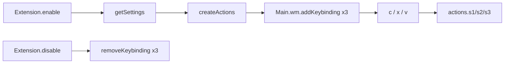
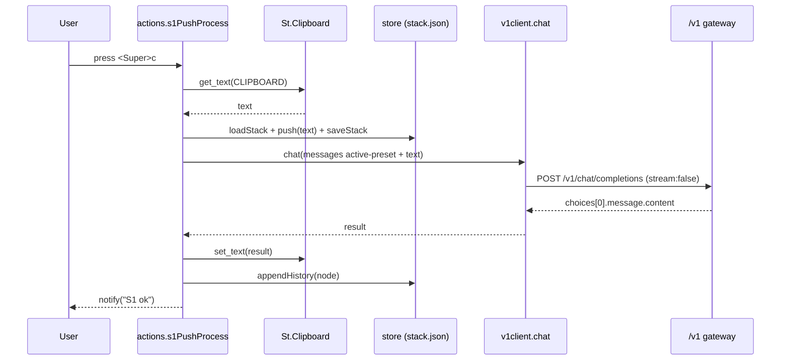
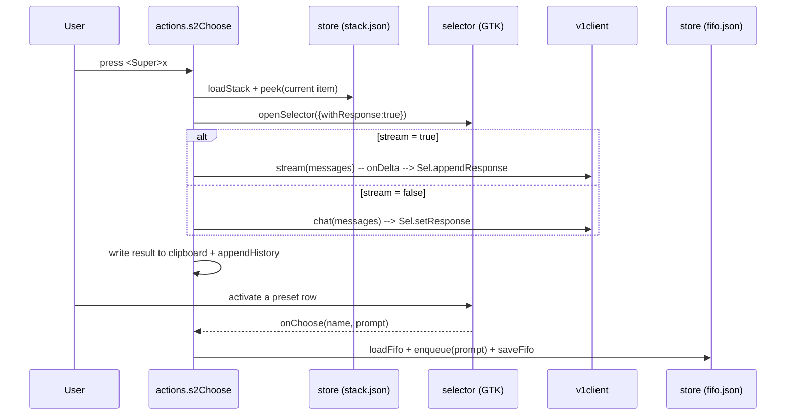
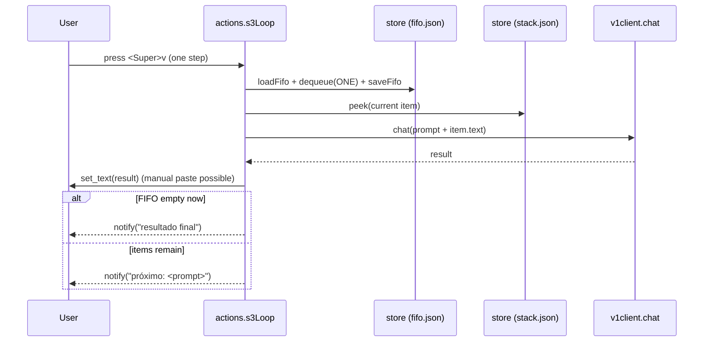
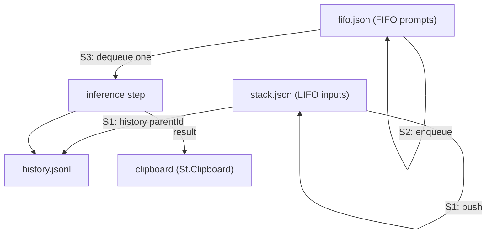

# Architecture — Nexus Clip GNOME Extension

A GNOME Shell 50 extension (ESM / GJS) that turns the clipboard into an LLM inference
pipeline over an OpenAI-compatible `/v1` endpoint. Three global shortcuts drive a **LIFO
stack** of inputs, a **FIFO** of chosen prompts, and a GTK window for prompt selection.

> Scope: **POC, linear.** The `/v1` HTTP contract is the integration seam for a future
> C + llama.cpp implementation. Tree/branching is a Non-Goal for now (but the state model
> is already tree-ready — see §5).

---

## 1. Runtime & constraints

- **GNOME Shell 45–50**, developed/validated on **50.3 Wayland**. ESM is mandatory
  (GNOME 45+); `imports.gi` legacy loading is **not** used.
- **GJS** with `gi://Soup` (libsoup3), `gi://St`, `gi://Gtk`/`Ado` (prefs), and the
  GNOME Shell resource modules.
- Hard constraints discovered empirically (see `docs/adr/0002`, `0003`):
  - `Soup.Session.send_and_read_async` is **not promisified** by GJS → pass the callback.
  - `send_finish()` on a `send_async` result returns a `Gio.InputStream` to read in chunks.
  - GJS `TextDecoder` has **no `{stream:true}`** → a pure incremental UTF-8 decoder is used.
  - The gateway keeps the socket open after `data: [DONE]` → `[DONE]` is the terminator.

---

## 2. Module map

```
extension/
├── metadata.json              # uuid nexus-clip@bbanho, settings-schema, shell-version 45..50
├── extension.js               # Extension subclass: enable()/disable() + keybindings
├── prefs.js                   # ExtensionPreferences: API / Presets / Hotkeys pages
├── schemas/
│   └── org.gnome.shell.extensions.nexus-clip.gschema.xml
└── lib/
    ├── actions.js             # S1/S2/S3 orchestration (clipboard + store + client + selector)
    ├── v1client.js            # HTTP: chat() (non-stream) and stream() (SSE)
    ├── v1core.js              # PURE: buildMessages / buildPayload / parseCompletion
    ├── sse.js                 # PURE: createSseParser + createUtf8Decoder
    ├── store.js               # PURE(+fs): LIFO stack, FIFO, history; schemaVersion'd
    └── selector.js            # GTK window: preset list (+ live response area)

tests/                         # node --test (run outside the shell)
├── store.test.js
├── v1core.test.js
└── sse.test.js
```

| Module | Responsibility | Testable in Node? |
|--------|----------------|-------------------|
| `v1core.js` | Payload/message building + completion parsing | ✅ pure |
| `sse.js` | SSE framing + incremental UTF-8 decoding | ✅ pure |
| `store.js` | LIFO/FIFO/history persistence | ✅ pure (injectable dir) |
| `v1client.js` | Network I/O (libsoup3) | ⚠️ GJS only |
| `selector.js` | GTK window | ⚠️ GJS/UI only |
| `actions.js` | Orchestration (`St.Clipboard`, notify) | ⚠️ GJS only |
| `prefs.js` | Preferences UI | ⚠️ GJS/UI only |

**Principle:** all *logic* lives in pure modules tested by `node --test`; the GJS/UI
modules stay thin and are validated manually in the shell (`EVIDENCE.md`).

---

## 3. Extension lifecycle



- `enable()` reads GSettings, builds the action set, and registers three shell keybindings
  (`hotkey-push`, `hotkey-choose`, `hotkey-loop`) with `IGNORE_AUTOREPEAT` in `NORMAL` mode.
- `disable()` removes them and drops references. No timers/loops are left running.

---

## 4. Data flow

### S1 — push + process (`<Super>c`)



### S2 — choose prompt (`<Super>x`)



### S3 — loop, stepwise (`<Super>v`)



**Invariant:** S3 consumes **exactly one** FIFO item per activation. It never drains the
FIFO in a single press — the user needs the intermediate steps and manual pastes.

---

## 5. State model

Config lives in GSettings/dconf (no secrets in the repo). Data lives under
`~/.local/share/nexus-clip-gnome/` (override with `NEXUS_CLIP_DATA_DIR`).

### `stack.json` — LIFO of inputs

```json
{ "schemaVersion": 1, "items": [ { "id": "item_...", "parentId": null, "text": "...", "ts": 0 } ] }
```
Newest item is `items[0]` (`push` = `unshift`). Optional `maxItems` (default 200) and
`dedupe` (default true, compares against the current top).

### `fifo.json` — FIFO of chosen prompts

```json
{ "schemaVersion": 1, "items": [ { "id": "item_...", "prompt": "...", "ts": 0 } ] }
```
`enqueue` = `push` (append), `dequeue` = `shift` (from the front).

### `history.jsonl` — append-only inference log

One JSON object per line:
```json
{ "id": 0, "parentId": "item_...", "text": "<result>", "ts": 0, "prompt": "<optional>" }
```

### Tree-readiness (future)

Every node carries `id` + `parentId`, so a branching tree can be layered on top **without a
schema break**. `schemaVersion: 1` allows forward migration when the shape evolves.



---

## 6. HTTP contract

- **Endpoint:** `POST http://localhost:8010/v1/chat/completions` (configurable).
- **Headers:** `Authorization: Bearer <api-key>`, `Content-Type: application/json`,
  `Accept: text/event-stream` when streaming.
- **Body:** `{ "model": "<model-name>", "messages": [{role,content}...], "stream": <bool> }`
  (built by `v1core.buildPayload`; system message = active preset).
- **Non-stream response:** `choices[0].message.content` → `parseCompletion`.
- **Stream response (SSE):**
  ```
  data: {"choices":[{"index":0,"delta":{"content":"..."},"finish_reason":null}]}
  ...
  data: [DONE]
  ```
  Parsed by `sse.createSseParser`; the client treats `[DONE]` as terminal (the gateway does
  not send EOF promptly — see `docs/adr/0003`).

---

## 7. Settings (GSettings schema keys)

| Key | Type | Default | Used by |
|-----|------|---------|---------|
| `api-endpoint` | `s` | `http://localhost:8010/v1/chat/completions` | S1/S2/S3 |
| `model-name` | `s` | `gemini-2.5-flash` | S1/S2/S3 |
| `api-key` | `s` | `random` | S1/S2/S3 |
| `presets` | `s` (JSON object) | 4 seeds | S1/S2 (active preset) + selector |
| `stream` | `b` | `false` | S2 |
| `hotkey-push` | `as` | `['<Super>c']` | extension.js |
| `hotkey-choose` | `as` | `['<Super>x']` | extension.js |
| `hotkey-loop` | `as` | `['<Super>v']` | extension.js |

"Active preset" = the **first key** of the `presets` JSON object (see `docs/adr/0006`).

---

## 8. Non-goals (POC)

No tree/branching yet · no C++/llama.cpp · no providers other than OpenAI-compatible
`/v1/chat/completions` · no audio/voice, embeddings, vector store, or prefix KV-cache.

See `docs/adr/` for the decision log, `docs/DEVELOPMENT.md` for the dev workflow, and
`docs/TROUBLESHOOTING.md` for failure modes.
